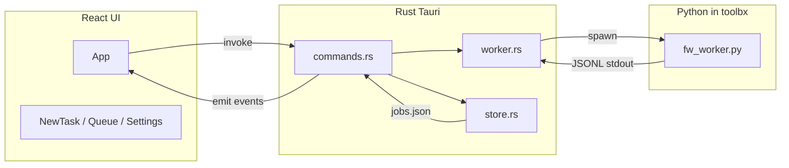

# Architecture

Transkribator is a Tauri v2 desktop app: a React frontend talks to a Rust backend via Tauri's `invoke()` (commands) and `listen()` (events). The backend runs a Python worker inside a toolbox container for transcription.

## High-level diagram

## Data flow

1. **User adds a task** → Frontend calls `invoke('start_job', { payload })` → Rust enqueues the job and persists it via `store::save_jobs` (jobs.json in app data dir).
2. **Queue loop** (background thread in `commands.rs`) picks a pending job, spawns `toolbox run -c asr -- .../fw_worker.py ...` with args (input, output_dir, model, etc.). Worker reads audio/video, runs faster-whisper, writes JSONL events to stdout.
3. **Rust worker** (`worker.rs`) reads stdout line by line, parses JSON (type: init, progress, status, stats, done, error, warning), updates the in-memory job state, and emits Tauri events: `job:started`, `job:progress`, `job:stats`, `job:status`, `job:done`, `job:error`, `job:warning`.
4. **Frontend** (`useJobEvents` in App) listens to these events and updates React state (progress, logs, job list). Metrics poller in Rust emits `job:stats` every second for the running job.
5. **Persistence**: On startup, `store::load_jobs` reads jobs.json; running/pending jobs are reset to error so they can be retried. Path resolution (`paths.rs`) handles Fedora Atomic `/home` ↔ `/var/home` for both host and toolbox.

## Tauri commands (Frontend → Backend)

| Command | Purpose |
|--------|---------|
| `start_job` | Create and enqueue a transcription job (payload: input_path, output_dir, formats, model, etc.). |
| `cancel_job` | Send kill to the running process of a job. |
| `list_jobs` | Return list of job summaries for the queue UI. |
| `get_job` | Return full job detail (for viewer, error details). |
| `remove_job` | Remove a non-running job from the list and persist. |
| `retry_job` | Create a new job with the same payload as a failed/canceled job. |
| `clear_completed_jobs` | Remove all done/error/canceled jobs and persist. |
| `open_folder` | Open a path in the system file manager (xdg-open). |
| `update_settings` | Update container name and venv path in memory. |
| `get_settings` | Return current container name and venv path. |
| `read_file` | Read text file; path must be under app data dir or a job output_dir. |
| `save_file` | Write text to file; same path restriction. |

## Tauri events (Backend → Frontend)

| Event | When | Payload |
|-------|------|---------|
| `job:started` | Worker process spawned | job_id, pid |
| `job:progress` | Transcription progress update | job_id, pct, eta_sec, segment_preview, ... |
| `job:stats` | CPU/RAM metrics (every 1s for running job) | job_id, cpu_system, ram_proc_mb, ... |
| `job:status` | Status message from worker | job_id, message |
| `job:done` | Job finished successfully | job_id, outputs[], stats |
| `job:error` | Job failed or was killed | job_id, message, details, stderr_tail |
| `job:warning` | Non-fatal warning from worker | job_id, message |

## Persistence

- **jobs.json** (in app data dir, e.g. `~/.local/share/transkribator/`): One JSON file with `{ version: 1, jobs: [...] }`. Legacy format (bare array) is supported on load. Atomic write (temp file + rename) and retry on save. Running/pending jobs are converted to error on app restart.

## Key files

- **Frontend**: [src/App.tsx](../src/App.tsx), [src/stores/jobStore.tsx](../src/stores/jobStore.tsx), [src/hooks/useJobEvents.ts](../src/hooks/useJobEvents.ts).
- **Backend**: [src-tauri/src/commands.rs](../src-tauri/src/commands.rs), [src-tauri/src/worker.rs](../src-tauri/src/worker.rs), [src-tauri/src/store.rs](../src-tauri/src/store.rs), [src-tauri/src/validation.rs](../src-tauri/src/validation.rs).
- **Worker**: [python/fw_worker.py](../python/fw_worker.py), [python/exporters.py](../python/exporters.py).
